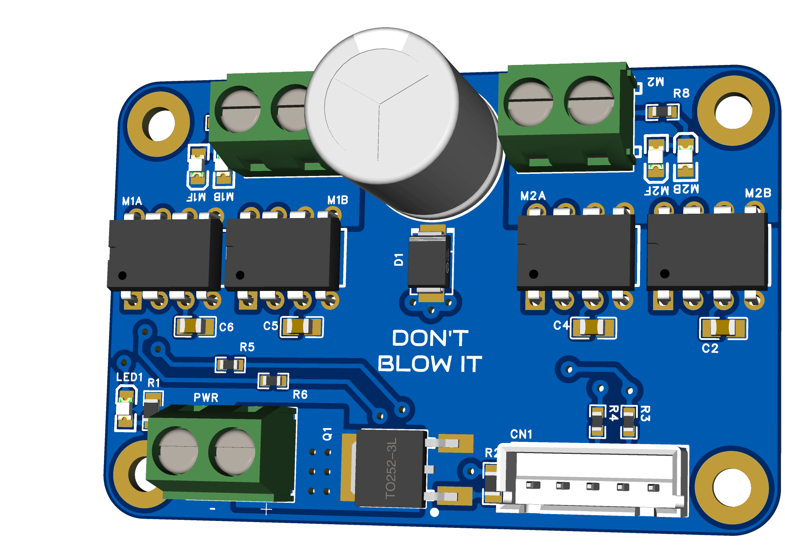

# KD1 Rev 2 Dual Motor Driver

I designed the complete board in EasyEDA Pro. Dual brushed DC motor driver with two RZ7886 devices per channel and separate forward and reverse inputs. KD1 Rev 2 was built and tested. The exact tested layout was not specified.

